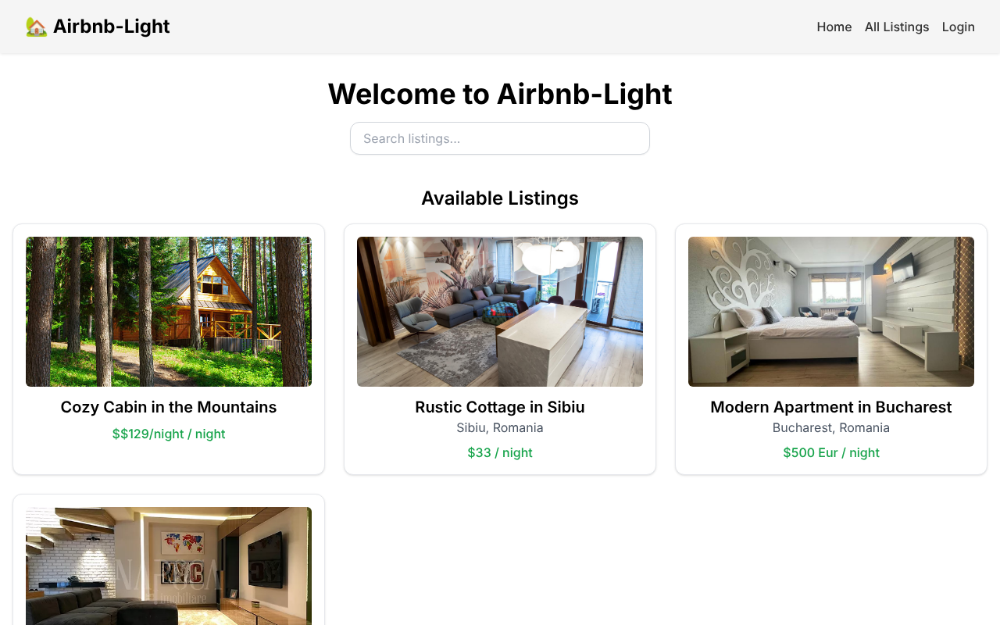

# airbnb-light 

A minimalist Airbnb clone built with React, Firebase Authentication, and Firestore. Fully responsive and styled using Tailwind CSS.

**Download:** [latest release](https://github.com/alexalghisi/airbnb-light/releases/latest)



## Features
- User authentication (login/register with Firebase)
- Create and manage property listings
- View listings in grid format
- Mobile-friendly responsive design

## Tech Stack
- React
- Firebase (Auth + Firestore)
- Tailwind CSS
- React Router DOM

## Getting Started
```bash
npm install
npm run dev
